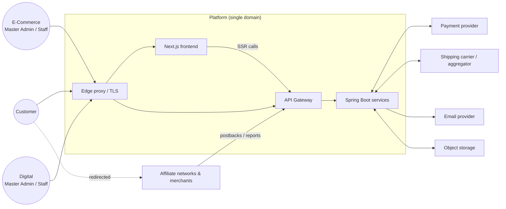
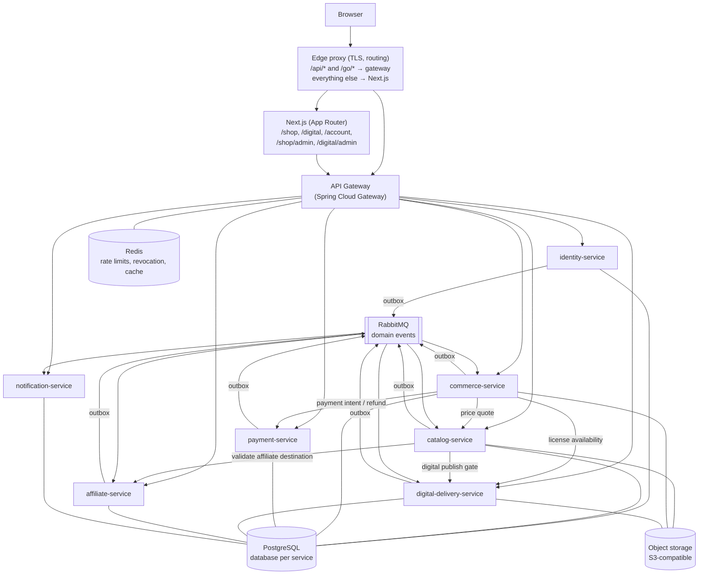

# Architecture — Hybrid Direct-Selling + Affiliate Product Platform

Status: **Original design.** The technology choices (microservices, Next.js, PostgreSQL) are superseded by
[ADR-001](ADR-001-stack.md): one Spring Boot application, plain HTML/JS, MySQL. Principles, storefront isolation and
product rules below still apply.
Scope: system architecture, boundaries, and key decisions. No business features are implemented yet.

Related documents:

- [MICROSERVICES.md](./MICROSERVICES.md) — service boundaries, ownership, events
- [DATABASE.md](./DATABASE.md) — data ownership and schema outlines
- [API-DESIGN.md](./API-DESIGN.md) — API conventions and endpoint map
- [SECURITY.md](./SECURITY.md) — authentication, authorization, threat controls
- [DEPLOYMENT.md](./DEPLOYMENT.md) — runtime topology, environments, CI/CD
- [PRODUCT-BEHAVIOR-MATRIX.md](./PRODUCT-BEHAVIOR-MATRIX.md) — behavior of the four product combinations

---

## 1. What we are building

One platform, one domain, one hosting infrastructure, serving two storefronts:

| Storefront | Public path | Admin path | Master Admin |
|---|---|---|---|
| E-Commerce (`SHOP`) | `/shop` | `/shop/admin` | E-Commerce Master Admin |
| Digital Products (`DIGITAL`) | `/digital` | `/digital/admin` | Digital Products Master Admin |

Every product has two independent attributes:

- `productType`: `PHYSICAL` | `DIGITAL`
- `sellingMethod`: `DIRECT` | `AFFILIATE`

All four combinations are first-class (see [PRODUCT-BEHAVIOR-MATRIX.md](./PRODUCT-BEHAVIOR-MATRIX.md)).

There is **no global/super admin**. Administrative authority is always scoped to exactly one storefront.

## 2. Architectural principles

1. **Backend is authoritative.** Price, stock, payment outcome, order status, permissions, digital entitlement and affiliate validation are decided only by backend services. The frontend renders and requests; it never decides.
2. **Storefront is a security boundary, not just a UI theme.** Every admin-owned record carries a `storefront` column and every admin query is filtered by the caller's storefront claim.
3. **Few, well-bounded services.** A service exists only where there is a distinct data owner, a distinct scaling/security profile, or a distinct failure domain. See §5 for services we deliberately did *not* create.
4. **Database per service.** No service reads another service's tables. Cross-service data flows through APIs or events.
5. **Synchronous where the user is waiting, asynchronous everywhere else.** Checkout pricing is a synchronous call; "order paid → grant entitlement → send email" is event-driven.
6. **Reliable events.** Transactional outbox for publishing, idempotent consumers for receiving. No dual writes.
7. **Money is integers.** Amounts are stored as `bigint` minor units plus an ISO-4217 currency code.
8. **Snapshots over references for history.** Orders and invoices snapshot product title, SKU, type, method and price at purchase time.
9. **Provider abstractions.** Payment, shipping, email, and object storage sit behind interfaces so providers can change without touching domain logic.
10. **No mock production logic.** Anything not implemented fails closed (e.g., returns `501`/disabled feature flag), never silently fakes success.

## 3. System context



## 4. Container view



## 5. Service decomposition (summary)

Full detail in [MICROSERVICES.md](./MICROSERVICES.md).

| Service | Owns |
|---|---|
| `api-gateway` | Routing, JWT pre-validation, cookie→token mapping, rate limiting, CORS, request IDs |
| `identity-service` | Customer accounts, storefront-scoped admin accounts, roles/permissions, tokens, MFA, JWKS, service clients |
| `catalog-service` | Products, variants, categories, prices, media metadata, affiliate offers, publishing workflow, search |
| `commerce-service` | Carts, checkout, orders, inventory & reservations, shipping/fulfillment, tax, invoices, address book |
| `payment-service` | Payment provider integration, payment intents, webhooks, refunds, reconciliation |
| `digital-delivery-service` | Digital assets (files), license keys, entitlements, secure download links |
| `affiliate-service` | Networks, merchants & domain allowlists, click tracking & redirects, conversions, commissions |
| `notification-service` | Templates, email (and later SMS) delivery, delivery log |

Deliberately **not** separate services (and why):

| Rejected service | Reason |
|---|---|
| inventory-service | Stock reservation must be transactionally consistent with order creation. Splitting forces a distributed transaction on the hottest path. Lives in `commerce-service`. |
| cart-service | Cart is a pre-order and is only meaningful with checkout. |
| shipping-service | Fulfillment is a lifecycle stage of an order line; carrier calls are behind an interface inside `commerce-service`. Can be extracted later if carrier integrations grow. |
| invoice-service | Invoices are derived, immutable documents of orders; numbering must be transactionally tied to the paid order. |
| admin-service | Would become a god-service that reaches into everyone's data. Each owning service exposes its own storefront-scoped admin endpoints. The admin "aggregation" happens in the Next.js admin UI. |
| search-service | PostgreSQL full-text search in `catalog-service` is sufficient initially. Revisit (OpenSearch) only on measured need. |
| config-server / service registry | Docker DNS + environment configuration is enough. Avoids Eureka/Config Server operational overhead. |

## 6. Storefront and admin model

- `storefront` ∈ {`SHOP`, `DIGITAL`} is a column on every admin-managed aggregate (products, categories, orders, invoices, merchants, templates, assets, …).
- **Customers are global.** One customer account works on both storefronts (same domain, shared `/account`).
- **Admin accounts are storefront-bound.** An admin account belongs to exactly one storefront. The same human administering both storefronts has two separate accounts with separate credentials and MFA. There is no role, claim, or code path that spans both storefronts.
- **Master Admin** = holder of the `MASTER_ADMIN` role *within one storefront*. Master Admins manage that storefront's staff and roles. Staff roles are finer-grained (catalog, orders, fulfillment, support, finance, affiliate, content).
- **Bootstrap:** the first Master Admin of each storefront is created by an operator-run CLI command in `identity-service` (not an HTTP endpoint), with forced password change and mandatory MFA enrollment at first login.
- **Orders belong to one storefront.** Carts are per customer per storefront, so each Master Admin sees only their own orders, revenue, invoices and customers-who-ordered.
- A product's `storefront` is independent of its `productType`. The expected norm is PHYSICAL in SHOP and DIGITAL in DIGITAL, but the model allows e.g. an e-book in SHOP. Whether to permit cross-placement is a business decision (see Assumptions).

## 7. Key flows (summary)

Full step-by-step flows live in [MICROSERVICES.md §4](./MICROSERVICES.md#4-end-to-end-flows).

- **Direct sale:** cart → server-side quote (catalog prices, commerce tax/shipping) → order `PENDING_PAYMENT` + stock reservation → payment intent → provider webhook → order `PAID` → events drive fulfillment, entitlement, invoice, notification.
- **Affiliate sale:** no cart, no order, no payment. "Buy at merchant" links to `/go/{code}` → `affiliate-service` validates link + merchant allowlist, records click, 302-redirects with a click ID → merchant/network reports conversion → commission lifecycle.
- **Digital (direct):** on `OrderPaid`, `digital-delivery-service` creates entitlements (and assigns license keys); customer requests a short-lived signed download URL per asset; refund revokes entitlement.
- **Physical (direct):** on `OrderPaid`, reservations are committed to stock; fulfillment creates shipments, tracking numbers flow from admin entry or carrier webhooks; status events trigger notifications.

## 8. Cross-cutting concerns

### 8.1 Communication

| Kind | Mechanism | Used for |
|---|---|---|
| Edge → services | HTTPS via gateway, JSON REST | All browser and SSR traffic |
| Service → service (sync) | REST on internal network, `/internal/**` paths, OAuth2 client-credentials token | Price quotes, payment intent creation, URL validation, license availability |
| Service → service (async) | RabbitMQ topic exchange `platform.events`, JSON events with schema version | State changes (`OrderPaid`, `PaymentSucceeded`, `ProductPublished`, …) |
| Third parties → platform | Webhooks through gateway to owning service | Payment, carrier, affiliate postbacks |

### 8.2 Consistency

- Each service is strongly consistent internally (single PostgreSQL transaction).
- Across services: eventual consistency via outbox + idempotent consumers.
- Checkout is an **orchestrated saga** owned by `commerce-service`: reserve stock → create payment → await payment event → commit or compensate (release reservation, cancel order, auto-refund if payment arrives after expiry and stock is gone).

### 8.3 Idempotency

- Client-facing state-changing endpoints with money or side effects (`checkout`, `refund`, admin `publish`) require an `Idempotency-Key` header.
- Webhooks deduplicate on provider event ID.
- Event consumers deduplicate on event ID (`processed_events` table).

### 8.4 Observability

- Structured JSON logs with `traceId`, `requestId`, `storefront`, never tokens or full PII.
- OpenTelemetry traces propagated gateway → services → broker.
- Micrometer metrics via Actuator (Prometheus scrape).
- Business metrics: checkout conversion, payment failures, reservation expiries, affiliate clicks/conversions, download issuance.

### 8.5 Redis — where and why

Redis is used only where it is genuinely the right tool, and never as a source of truth:

| Use | Owner | Why Redis |
|---|---|---|
| Rate limiting (token buckets) | gateway | Shared counters across gateway replicas |
| Session revocation list (by `sid`) | gateway (read), identity (write) | Sub-millisecond check on every admin request |
| Login / OTP attempt throttling | identity | TTL counters |
| Optional public catalog read cache | catalog | Hot product pages; safe to lose |

Carts, orders, entitlements and clicks are **not** stored in Redis.

### 8.6 Object storage abstraction

An `ObjectStorage` port (put, presigned upload, presigned download, head, delete) with an S3-compatible adapter. MinIO locally; S3 / Cloudflare R2 / any S3-compatible service in production. Two logical buckets:

- `public-media` — product images, served via CDN.
- `private-digital` — sellable files and invoices; never publicly readable; access only through short-lived presigned URLs issued by the owning service.

## 9. Technology baseline

| Layer | Choice | Note |
|---|---|---|
| Frontend | Next.js (App Router), React, TypeScript | Single app hosting both storefronts and both admin panels; route-level code splitting keeps admin code out of storefront bundles |
| Backend | Java (LTS; 21 minimum, 25 preferred), Spring Boot, Spring Security, Spring Data JPA | Exact versions pinned at scaffolding time |
| Gateway | Spring Cloud Gateway | Same language/tooling as services |
| Auth server capabilities | Spring Security + Spring Authorization Server (for service clients and JWKS) | First-party password login, no third-party IdP required initially |
| DB | PostgreSQL | One database per service; Flyway migrations |
| Messaging | RabbitMQ | Simpler to operate than Kafka at this scale; outbox pattern |
| Cache / counters | Redis | See §8.5 |
| Storage | S3-compatible | MinIO locally |
| Build | Maven multi-module (backend), pnpm (frontend) | |
| Contracts | OpenAPI 3.1 per service, JSON Schema per event | Frontend TS client generated from OpenAPI |
| Testing | JUnit 5, Testcontainers, Spring REST Docs/contract tests, Playwright (frontend E2E) | |
| Runtime | Docker, Docker Compose | See [DEPLOYMENT.md](./DEPLOYMENT.md) |

## 10. Proposed repository structure

```
Hybrid-Product-Platform/
├── README.md
├── docs/                                 # Architecture documents (this folder)
├── contracts/
│   ├── openapi/                          # One OpenAPI spec per service (source of truth for APIs)
│   └── events/                           # JSON Schemas for domain events, versioned
├── frontend/                             # Next.js App Router application
│   └── src/
│       ├── app/
│       │   ├── (public)/                 # "/", login, register, legal pages
│       │   ├── account/                  # Shared customer account (orders, library, addresses)
│       │   ├── shop/
│       │   │   ├── (storefront)/         # /shop storefront pages + storefront layout
│       │   │   └── admin/                # /shop/admin (own layout, own auth gate)
│       │   └── digital/
│       │       ├── (storefront)/         # /digital storefront pages + storefront layout
│       │       └── admin/                # /digital/admin (own layout, own auth gate)
│       ├── features/                     # Feature modules (catalog, cart, checkout, library, admin-*)
│       ├── components/                   # Shared UI primitives
│       ├── lib/
│       │   ├── api/                      # Generated OpenAPI client + server-side fetch wrapper
│       │   └── auth/                     # Cookie/session helpers (UX only, not authorization)
│       └── middleware.ts                 # Redirects for missing sessions (UX only)
├── backend/
│   ├── pom.xml                           # Maven parent / BOM
│   ├── libs/                             # Thin shared libraries — NO shared domain models
│   │   ├── platform-security/            # JWT resource-server config, storefront scope checks
│   │   ├── platform-events/              # Outbox, event envelope, idempotent consumer support
│   │   ├── platform-web/                 # Problem+JSON errors, idempotency filter, pagination
│   │   └── platform-test/                # Testcontainers base classes
│   └── services/
│       ├── api-gateway/
│       ├── identity-service/
│       ├── catalog-service/
│       ├── commerce-service/
│       ├── payment-service/
│       ├── digital-delivery-service/
│       ├── affiliate-service/
│       └── notification-service/
├── infra/
│   ├── docker/
│   │   ├── compose/                      # docker-compose.yml (+ dev/prod overrides)
│   │   └── postgres/init/                # Per-service database & role creation scripts
│   ├── edge/                             # Edge proxy config (TLS, path routing)
│   └── observability/                    # Prometheus, Grafana, OTel collector config
└── scripts/                              # Dev tooling (bootstrap admin, seed dev data)
```

Each backend service uses the same internal layout:

```
<service>/src/main/java/com/platform/<service>/
├── api/              # REST controllers, request/response DTOs, mappers
├── application/      # Use cases / application services, transactions
├── domain/           # Entities, value objects, domain rules, repository ports
├── infrastructure/   # JPA adapters, messaging, external provider adapters
└── config/           # Spring configuration, security
src/main/resources/db/migration/   # Flyway migrations (service-owned)
```

## 11. Frontend routing strategy

One Next.js App Router application serves every user-facing path on the single domain. The edge proxy sends `/api/*` and `/go/*` to the gateway; everything else goes to Next.js.

| Path | Audience | Rendering | Notes |
|---|---|---|---|
| `/` | Public | SSG/ISR | Landing page linking both storefronts |
| `/login`, `/register`, `/forgot-password`, `/verify-email` | Customers | Dynamic | One customer identity for both storefronts |
| `/shop`, `/shop/c/[category]`, `/shop/p/[slug]`, `/shop/search` | Public | ISR (revalidate on `ProductPublished` via on-demand revalidation) | Affiliate products render a "Buy at merchant" link to `/go/{code}` |
| `/shop/cart`, `/shop/checkout`, `/shop/checkout/complete` | Customer | Dynamic, `no-store` | Complete page polls order status |
| `/digital`, `/digital/c/[category]`, `/digital/p/[slug]`, `/digital/search` | Public | ISR | |
| `/digital/cart`, `/digital/checkout`, `/digital/checkout/complete` | Customer | Dynamic | |
| `/account`, `/account/orders`, `/account/orders/[id]`, `/account/library`, `/account/addresses` | Customer | Dynamic | Shared across storefronts, filterable by storefront |
| `/shop/admin/login`, `/shop/admin/**` | SHOP admins | Dynamic, client-heavy | Own layout; never wrapped by storefront layout |
| `/digital/admin/login`, `/digital/admin/**` | DIGITAL admins | Dynamic | Own layout |
| `/go/[code]` | Public | Not Next.js | Served by affiliate-service via gateway (fast 302) |

Layout isolation uses route groups so admin areas do not inherit storefront chrome:

```
app/shop/(storefront)/layout.tsx   → storefront header/footer for /shop/**
app/shop/admin/layout.tsx          → admin shell for /shop/admin/**
```

`middleware.ts` only improves UX: it redirects to the right login page when the expected cookie is missing (customer cookie for `/account`, `/*/checkout`; shop-admin cookie for `/shop/admin`; digital-admin cookie for `/digital/admin`). It makes **no** authorization decisions. Every protected server component fetches through the gateway, and a `401`/`403` from the backend is what actually denies access.

## 12. Assumptions

1. **Affiliate meaning (confirmed).** "Affiliate product" means a product sold by an external merchant, where we earn commission through an affiliate network or program. The platform must support **any affiliate link** (Amazon Associates, Flipkart, Cuelinks, EarnKaro, Impact, CJ, ShareASale, direct merchant programs, shortened links such as `amzn.to`, etc.) — see [MICROSERVICES.md §2.7](./MICROSERVICES.md#27-affiliate-service). An *inbound* affiliate/referral program (third parties promoting our DIRECT products) and any multi-level / network-marketing compensation are **out of scope**. The affiliate-service boundary allows adding them later.
2. **Storefront placement.** A product's `storefront` is independent of `productType`. The model allows a DIGITAL product in SHOP, and vice versa. Business may later restrict this with a validation rule.
3. **Customers are global, admins are storefront-bound.** The same person administering both storefronts holds two separate accounts.
4. **Checkout requires a customer account** (verified email) in v1. Guest checkout is a later feature flag.
5. **One currency per storefront**, configured. Multi-currency is out of scope for v1.
6. **Payment provider: Razorpay** (confirmed). Razorpay Orders API + Checkout on the frontend, payment confirmation only via signature-verified webhooks (`payment.captured`, `payment.failed`, `refund.processed`) and server-side signature verification of the checkout callback. It sits behind the `PaymentProvider` port so another provider could be added later.
7. **Manual shipping** in v1: admins enter tracking numbers. A carrier or aggregator adapter comes later.
8. **Table-driven tax** per storefront in v1. Jurisdiction rules (e.g. GST) must be confirmed, along with invoice legal requirements such as numbering format and seller tax IDs.
9. **No promotions or coupons** in v1. The order model already has `discount_minor`, so they can be added without a schema break.
10. **Email only** for notifications in v1. SMS comes later.
11. **Platform-wide configuration** (provider keys, domains, secrets) is managed by operators through infrastructure, not through any admin UI. This is how we avoid needing a global admin.
12. **RabbitMQ** is acceptable as an added infrastructure component (not in the original list), because reliable async events are required.

## 13. Architectural risks

| Risk | Impact | Mitigation |
|---|---|---|
| Distributed-system overhead for a small team (8 deployables) | Slower delivery, harder local dev | Shared libs for infra boilerplate, one Compose file, contract tests; services kept coarse-grained |
| Eventual consistency confuses users (e.g. "paid but library empty for a few seconds") | Support tickets | "Processing" states in UI, polling, fast consumers, alerts on outbox/queue lag |
| Late payment after reservation expiry | Paid order with no stock | `PAID_UNFULFILLABLE` path with automatic refund and notification; reservation TTL ≥ payment session TTL |
| Missed payment webhooks | Orders stuck in `PENDING_PAYMENT` | Reconciliation job against provider API |
| No global admin means nobody can act cross-storefront (customer erasure, fraud spanning both storefronts) | Operational gaps | Operator-run, audited CLI runbooks; customer self-service privacy endpoints |
| Admin lockout (last Master Admin loses MFA) | Storefront unmanageable | Last-Master-Admin guard; audited operator recovery CLI with out-of-band verification |
| Affiliate attribution depends on network data quality and timing | Under-reported commission | Both postback and CSV import; conversions start as `PENDING`; reconciliation reports |
| Leaked download links | Revenue loss | Short TTL, per-entitlement limits, anomaly alerts; optional watermarking later |
| License pool exhaustion between quote and payment | Paid order without key | Availability check at checkout; `LicensePoolLow` alerts; fallback to manual fulfillment with refund option |
| Single-host Compose in production | Downtime on host failure or deploy | Documented migration path to Kubernetes/ECS; managed DB/Redis/MQ reduce blast radius |
| Single Next.js app for storefronts and admins | Shared deploy and failure domain; admin code in the same repo bundle graph | Route-level code splitting, strict CSP, backend-enforced authz; split admin into its own app if needed |
| Invoice numbering must be gapless and legally compliant | Compliance exposure | Row-locked sequence in the payment-confirmation transaction; confirm legal format before launch |

## 14. Architecture decision summary

| # | Decision | Alternatives considered |
|---|---|---|
| AD-1 | 7 business services + gateway | Modular monolith (simpler, but requirement is microservices); 12+ services (needless distributed transactions) |
| AD-2 | Storefront-bound admin accounts, no super admin | Single admin account with multi-storefront roles (violates "no global admin") |
| AD-3 | Affiliate products never enter cart/order/payment | Treating affiliate as a zero-price order line (pollutes revenue, invoices, and stock) |
| AD-4 | Inventory inside commerce-service | Separate inventory service with 2PC/saga on every checkout |
| AD-5 | RabbitMQ + transactional outbox | Kafka (heavier ops), Redis Streams (weaker durability guarantees), synchronous chains (cascading failure) |
| AD-6 | HttpOnly cookies at the edge, JWT inside | Tokens in localStorage (XSS-exfiltratable) |
| AD-7 | Gateway validates *and* services re-validate JWTs | Trusting gateway-injected headers (one misroute = full bypass) |
| AD-8 | One Next.js app for all four surfaces | Separate admin app (stronger isolation, more deployment overhead) — revisit if admin grows |
| AD-9 | PostgreSQL database-per-service on one cluster initially | Separate clusters per service (cost) or shared schema (coupling) |
