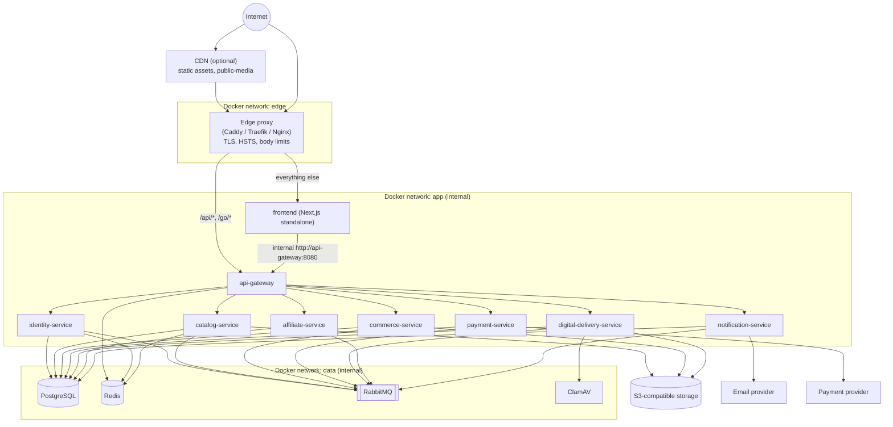
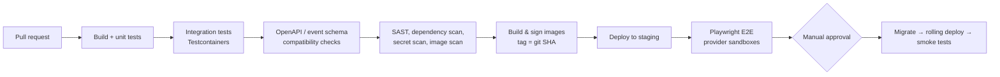

# Deployment Architecture

> **Superseded by [ADR-001](ADR-001-stack.md):** one container (Spring Boot + bundled frontend) plus MySQL. See the
> README sections "Docker" and "Production checklist".

Status: **Proposed (pre-implementation)**

---

## 1. Environments

| Environment | Purpose | Runtime | Data stores |
|---|---|---|---|
| `local` | Developer machine | Docker Compose (all containers) | Postgres, Redis, RabbitMQ, MinIO, Mailpit, ClamAV in containers |
| `staging` | Pre-production, provider sandboxes | Docker Compose on a VM (or same orchestrator as prod) | Managed or containerized; isolated from prod |
| `production` | Live | Docker Compose on hardened VM(s) initially; designed to move to Kubernetes / ECS without code changes | Managed PostgreSQL, managed Redis, managed/clustered RabbitMQ, S3-compatible object storage, transactional email provider |

All services are 12-factor: configuration via environment variables, secrets via mounted secrets, stateless containers, logs to stdout.

## 2. Runtime topology



Network rules:

- Only the edge proxy publishes host ports (443, and 80 for redirect / ACME).
- `app` and `data` networks are `internal: true` — no direct exposure.
- Services reach third parties via egress; production can restrict egress to known provider hosts.
- Service discovery: Docker DNS names (`catalog-service:8080`). No Eureka/Consul.

## 3. Containers

| Container | Image base | Port (internal) | Health check | Replicas (prod start) |
|---|---|---|---|---|
| edge | caddy / traefik | 80, 443 (published) | built-in | 1 (2 with LB) |
| frontend | node LTS (Next.js `output: standalone`) | 3000 | `/api/health` (Next route) | 2 |
| api-gateway | eclipse-temurin JRE (distroless/alpine) | 8080 | `/actuator/health/readiness` | 2 |
| identity-service | JRE | 8080 | readiness | 2 |
| catalog-service | JRE | 8080 | readiness | 2 |
| commerce-service | JRE | 8080 | readiness | 2 |
| payment-service | JRE | 8080 | readiness | 2 |
| digital-delivery-service | JRE | 8080 | readiness | 2 |
| affiliate-service | JRE | 8080 | readiness | 2 |
| notification-service | JRE | 8080 | readiness | 1 |
| postgres (local/staging) | postgres | 5432 | `pg_isready` | 1 |
| redis (local/staging) | redis | 6379 | `redis-cli ping` | 1 |
| rabbitmq (local/staging) | rabbitmq:management | 5672 / 15672 | `rabbitmq-diagnostics ping` | 1 |
| minio (local) | minio | 9000 / 9001 | `/minio/health/live` | 1 |
| mailpit (local) | mailpit | 1025 / 8025 | — | 1 |
| clamav | clamav | 3310 | clamd ping | 1 |

Image rules: multi-stage builds, non-root user, read-only root filesystem where possible, no shell in production images where feasible, pinned base image digests, SBOM generated in CI.

JVM: container-aware memory (`-XX:MaxRAMPercentage=75`), Spring Boot layered jars for cache-efficient builds; virtual threads enabled for blocking I/O services.

## 4. Compose layout (to be created during scaffolding)

```
infra/docker/compose/
├── docker-compose.yml           # All services + infra, production-like defaults
├── docker-compose.dev.yml       # Local overrides: MinIO, Mailpit, exposed debug ports, hot reload for frontend
├── docker-compose.prod.yml      # Prod overrides: external managed DB/Redis/MQ endpoints, replicas, resource limits
└── .env.example                 # Non-secret variable names only
infra/docker/postgres/init/
└── 01-create-databases.sql      # Creates 7 databases + owner/app roles (local/staging only)
infra/edge/
└── Caddyfile (or traefik.yml)   # /api/* and /go/* → gateway; rest → frontend
infra/observability/
├── prometheus.yml
├── otel-collector.yaml
└── grafana/dashboards/
```

Startup ordering via `depends_on: condition: service_healthy`; services also retry connections on boot (never rely solely on ordering).

## 5. Configuration and secrets

- Per-service env vars: `SPRING_DATASOURCE_URL`, `SPRING_RABBITMQ_*`, `REDIS_URL`, `OBJECT_STORAGE_*`, `IDENTITY_JWKS_URI`, `SERVICE_CLIENT_ID/SECRET`, provider keys.
- Secrets mounted as files (`/run/secrets/...`) and read via Spring's `configtree:` import. Production values come from a secret manager.
- Feature flags (e.g. `features.guest-checkout=false`) via config; unimplemented features fail closed.

## 6. Database migrations

- Flyway runs on service startup with the owner role in local/staging.
- Production: migrations run as a one-off job (`<service> --migrate-only` profile) before rolling out new app containers; app containers run with the DML-only role.
- Expand/contract pattern so old and new versions can run side by side during rollout.

## 7. CI/CD



- Monorepo with path filters: only changed services rebuild/redeploy.
- Images pushed to a private registry, immutable tags (git SHA), promoted across environments (no rebuild for prod).
- Rollback: redeploy previous SHA; migrations are backward compatible by policy.

## 8. Observability

| Signal | Tooling |
|---|---|
| Metrics | Micrometer → Prometheus → Grafana (JVM, HTTP, DB pool, RabbitMQ queue depth, business KPIs) |
| Traces | OpenTelemetry SDK/agent → OTel Collector → Tempo/Jaeger |
| Logs | JSON stdout → Loki (or cloud log service), correlated by `traceId` |
| Alerts | Error rate, p95 latency, DLQ depth > 0, outbox lag, webhook signature failures, payment success rate drop, reservation expiry spike, disk/DB connections |
| Uptime | External probe on `/`, `/shop`, `/digital`, `/api/v1/catalog/shop/products?limit=1` |

## 9. Scaling and availability

- All services stateless → horizontal scaling behind gateway/Docker DNS round-robin (Compose `deploy.replicas`) or orchestrator.
- Hot paths: catalog reads (cache + CDN), `/go/*` redirects (local read model, no sync calls), webhook intake (fast ack, async processing).
- Background jobs (reservation expiry, outbox relay, reconciliation, partition maintenance) use DB-based leader locking (e.g. ShedLock) so multiple replicas are safe.
- **Compose limitation:** single-host Compose has no cross-host failover or true zero-downtime rolling updates. Acceptable for launch with a small footprint; plan migration to Kubernetes (or ECS / Docker Swarm) when availability targets require multi-host. The container, config, and health-check design already supports that move.

## 10. Backup and disaster recovery

| Asset | Backup | Target RPO / RTO (initial) |
|---|---|---|
| PostgreSQL | PITR (WAL) + daily snapshots, cross-region copy | RPO ≤ 5 min / RTO ≤ 1 h |
| Object storage | Versioning + cross-region replication for `private-digital` | RPO ≤ 1 h |
| RabbitMQ | Durable queues on persistent volume; outbox can replay unpublished events | Recoverable from outbox |
| Redis | Not backed up (no source-of-truth data) | Rebuilt on start |
| Secrets | Secret manager with versioning | — |
