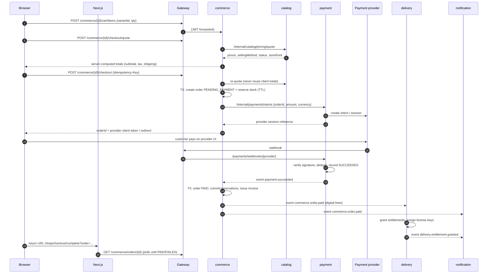
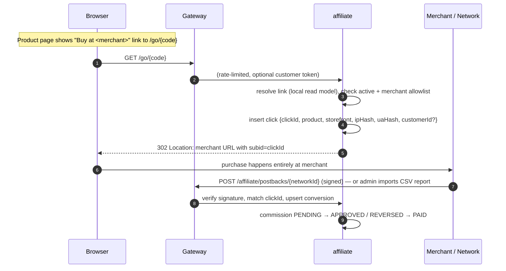

# Microservices

> **Superseded by [ADR-001](ADR-001-stack.md):** the platform is built as one Spring Boot application with MySQL.
> The service boundaries below map to packages inside that application.

Status: **Proposed (pre-implementation)**

This document defines each service's responsibility, owned data, public/internal surface, events, and the end-to-end flows that cross service boundaries.

---

## 1. Boundary rules

1. A service **owns** its data. Nobody else reads or writes its database.
2. A service is the **only authority** for the decisions listed under "Authoritative for".
3. Admin operations live in the service that owns the data, under `/api/v1/<service>/admin/{storefront}/**`.
4. Synchronous calls between services are allowed only when a user is actively waiting *and* the caller cannot proceed without the answer. Everything else is an event.
5. Shared libraries (`backend/libs/*`) contain infrastructure only (security config, outbox, error format). **No shared entities or DTOs** — each service defines its own.

## 2. Services

### 2.1 `api-gateway`

| | |
|---|---|
| Tech | Spring Cloud Gateway (reactive) |
| Owns data | None (reads Redis for rate limits and session revocation) |
| Authoritative for | Edge request policy only — it is *not* the authorization authority |

Responsibilities:

- Path-based routing to services (see [API-DESIGN.md §3](./API-DESIGN.md#3-gateway-routing)).
- Extract the correct token from the correct HttpOnly cookie based on route (customer vs shop-admin vs digital-admin) and forward it as `Authorization: Bearer`.
- Pre-validate JWT signature, expiry, audience; reject admin tokens whose `storefront` claim does not match the `{storefront}` path segment.
- Check session revocation list (Redis) for admin tokens.
- CSRF double-submit check for cookie-authenticated state-changing requests.
- Rate limiting (per IP, per account, stricter on auth, `/go/*`, webhooks).
- Strip any inbound `X-Internal-*`/`X-User-*` headers; block `/internal/**` entirely from outside.
- Request ID and trace propagation; access logs.

Does **not**: aggregate responses, contain business rules, or talk to databases.

### 2.2 `identity-service`

| | |
|---|---|
| Owns data | `identity_db` |
| Authoritative for | Authentication, admin roles & permissions, token issuance, service-client credentials |

Responsibilities:

- Customer registration, email verification, login, logout, password reset.
- Storefront-bound admin accounts (`SHOP` or `DIGITAL`), invitations, roles, permissions.
- Mandatory TOTP MFA for all admin accounts.
- Issues RS256 JWT access tokens (short-lived) and opaque rotating refresh tokens (hashed at rest, reuse detection).
- Publishes JWKS for gateway and services; supports key rotation.
- OAuth2 client-credentials for service-to-service tokens (Spring Authorization Server).
- Writes revoked session IDs to Redis on logout / forced sign-out / role change.
- Operator CLI: bootstrap the first Master Admin of a storefront.

Events published: `CustomerRegistered`, `CustomerEmailVerified`, `PasswordResetRequested`, `AdminInvited`, `AdminRoleChanged`, `AdminDisabled`.

### 2.3 `catalog-service`

| | |
|---|---|
| Owns data | `catalog_db` |
| Authoritative for | Product definition, `productType`, `sellingMethod`, `storefront`, list price, publish state, affiliate offer details |

Responsibilities:

- Products, variants (default variant always exists), categories, tags, media metadata.
- Product-combination validation rules (see [PRODUCT-BEHAVIOR-MATRIX.md](./PRODUCT-BEHAVIOR-MATRIX.md)).
- Pricing for DIRECT products (list price per variant per currency).
- Affiliate offer for AFFILIATE products: merchant reference, destination URL, indicative display price, disclosure text.
- Publish workflow `DRAFT → PUBLISHED → ARCHIVED`; validation gates on publish.
- Public listing/search (PostgreSQL full-text) per storefront.
- Presigned upload for public product images (`public-media` bucket).
- Internal pricing quote endpoint used by checkout.

Sync calls out (publish-time gates only, never on the storefront read path):

- `affiliate-service` — validate affiliate destination URL against the merchant allowlist.
- `digital-delivery-service` — confirm a DIGITAL+DIRECT product has at least one `READY` asset or a license pool.

Events published: `ProductPublished`, `ProductUpdated`, `ProductArchived`, `VariantPriceChanged`, `AffiliateOfferChanged`.

### 2.4 `commerce-service`

| | |
|---|---|
| Owns data | `commerce_db` |
| Authoritative for | Cart contents, order totals, order status, stock levels, reservations, shipping charges, tax, shipments, invoices |

Responsibilities (internal modules, one deployable):

- **cart** — per customer per storefront; stores variant IDs and quantities only (no trusted prices).
- **checkout** — quote and place order; saga orchestrator.
- **order** — order aggregate, state machine, status history, cancellation.
- **inventory** — stock per physical variant, reservations with TTL, movement ledger, admin adjustments.
- **fulfillment/shipping** — shipping methods & rates, shipments, tracking, carrier adapter (`ShippingProvider` port; manual provider first).
- **tax** — tax rules per storefront (`TaxCalculator` port; table-based first).
- **invoice** — gapless numbering per storefront and fiscal year, immutable invoice and credit-note records, PDF stored in `private-digital`.
- **address book** — customer shipping/billing addresses.

Sync calls out:

- `catalog-service` `/internal/catalog/pricing/quote` — authoritative price and sellability.
- `payment-service` `/internal/payments/intents` and `/internal/payments/{id}/refunds`.
- `digital-delivery-service` `/internal/delivery/availability` — license-key pool availability for license-based digital products.

Events published: `OrderPlaced`, `OrderPaid`, `OrderCancelled`, `OrderRefunded`, `ShipmentCreated`, `ShipmentDispatched`, `ShipmentDelivered`, `InvoiceIssued`, `StockLow`.

Events consumed: `PaymentSucceeded`, `PaymentFailed`, `RefundSucceeded`, `ProductArchived` (remove from carts), `VariantPriceChanged` (invalidate quotes).

### 2.5 `payment-service`

| | |
|---|---|
| Owns data | `payment_db` |
| Authoritative for | Whether money was captured or refunded |

Responsibilities:

- `PaymentProvider` port; the launch adapter is **Razorpay** (Orders API + Razorpay Checkout, so card/UPI data never touches our servers → PCI SAQ-A scope). Razorpay `order_id` is created server-side with the amount from `commerce-service`; the checkout callback signature (`razorpay_signature`) is verified server-side, and the `payment.captured` webhook (verified with `X-Razorpay-Signature`) is the authoritative success signal.
- Create payment intent for an order (amount and currency supplied by `commerce-service`, never by the browser).
- Receive and verify provider webhooks (signature, timestamp tolerance, event-ID dedupe).
- Refunds (full / partial) requested by `commerce-service` on admin action.
- Scheduled reconciliation against provider APIs to catch missed webhooks.

Events published: `PaymentSucceeded`, `PaymentFailed`, `PaymentRequiresAction`, `RefundSucceeded`, `RefundFailed`.

### 2.6 `digital-delivery-service`

| | |
|---|---|
| Owns data | `delivery_db`, `private-digital` bucket (asset prefix) |
| Authoritative for | Who may access which digital asset, license key assignment, download issuance |

Responsibilities:

- Digital asset lifecycle: presigned upload session → server-side verification (size, checksum, MIME sniff, malware-scan hook) → `READY`.
- Asset versioning (customers get new versions per product policy).
- License key pools (encrypted at rest), import, assignment on grant.
- Delivery policy per product: download limit, access duration, which asset versions.
- Entitlements: grant on `OrderPaid` (digital lines), revoke on refund/chargeback, admin manual grant/revoke (audited).
- Customer library and short-lived download link issuance (presigned GET, minutes-scale TTL, logged).

Events published: `EntitlementGranted`, `EntitlementRevoked`, `LicensePoolLow`.
Events consumed: `OrderPaid`, `OrderRefunded`, `ProductArchived`.

### 2.7 `affiliate-service`

| | |
|---|---|
| Owns data | `affiliate_db` |
| Authoritative for | Valid affiliate destinations, click records, conversion and commission status |

Responsibilities:

- Affiliate networks and merchants per storefront, including **allowed destination domains** and sub-ID URL templates.
- Local read model of affiliate links (built from `ProductPublished` / `AffiliateOfferChanged` events) so redirects never call catalog synchronously.
- `GET /go/{code}`: resolve link → re-validate destination against merchant allowlist → record click → `302` to destination with click ID substituted into sub-ID parameter.
- Bot filtering and click de-duplication (time window per session/IP hash).
- Conversion intake: signed network postbacks and admin CSV report imports; match on click ID.
- Commission lifecycle `PENDING → APPROVED → PAID` or `REVERSED`; reporting per storefront.

**Universal affiliate link support (confirmed requirement):**

- Admins paste the affiliate URL exactly as issued by any program or network. The link is stored and redirected to **unchanged** (affiliate tags such as `?tag=`, `affid=`, network deep links, and shortened links are preserved).
- When a link's host is not yet known, the admin confirms it and the host is registered as a merchant domain for that storefront in the same step (audited). The allowlist still protects against open redirects — only admin-approved hosts are ever redirected to — without blocking any program.
- URL rules: `https` only (http allowed per merchant if a program requires it), no credentials in URL, no IP-literal / localhost / private hosts, max length 2048.
- Sub-ID / click-ID injection is **optional per merchant**: if the program supports a sub-ID parameter (e.g. `subid`, `subId1`, `aff_sub`, `ascsubtag`), the click ID is appended; otherwise the URL is used as-is.
- Click tracking works for **every** affiliate link. Conversion tracking is per program capability: signed postbacks where supported, CSV report import otherwise, and "clicks only" for programs that provide neither (e.g. many marketplace programs only expose dashboard reports).

Events published: `AffiliateConversionRecorded`, `AffiliateConversionStatusChanged`.
Events consumed: `ProductPublished`, `AffiliateOfferChanged`, `ProductArchived`.

### 2.8 `notification-service`

| | |
|---|---|
| Owns data | `notification_db` |
| Authoritative for | What was sent to whom and when |

Responsibilities:

- Templates per storefront, channel, and locale (storefront branding differs).
- Consume domain events → render → send via `EmailSender` port (SMTP / SES / etc.).
- Retry with backoff, dead-letter, delivery log.
- Never contains business decisions; only reacts to events carrying everything needed to render (plus recipient lookup via event payload).

Events consumed: `CustomerRegistered`, `PasswordResetRequested`, `AdminInvited`, `OrderPaid`, `OrderCancelled`, `OrderRefunded`, `ShipmentDispatched`, `ShipmentDelivered`, `InvoiceIssued`, `EntitlementGranted`, `StockLow`, `LicensePoolLow`.

## 3. Event backbone

- Broker: RabbitMQ, topic exchange `platform.events`, routing key `<service>.<aggregate>.<event>` (e.g. `commerce.order.paid`).
- Each consuming service owns its queues (`delivery.order-paid`, `notification.order-paid`, …) with a dead-letter queue per consumer.
- Publishing: transactional outbox table in the producer DB; a relay publishes and marks rows sent. At-least-once delivery.
- Consuming: `processed_events(event_id)` table checked in the same transaction as the side effect → effectively-once processing.
- Envelope:

```json
{
  "eventId": "uuid",
  "eventType": "commerce.order.paid",
  "schemaVersion": 1,
  "occurredAt": "2026-10-05T11:53:00Z",
  "storefront": "SHOP",
  "producer": "commerce-service",
  "traceId": "…",
  "payload": { }
}
```

- Schemas live in `contracts/events/` and evolve additively; breaking changes bump `schemaVersion` and are dual-published during migration.

### Event catalog

| Event | Producer | Consumers |
|---|---|---|
| `identity.customer.registered` | identity | notification |
| `identity.password-reset.requested` | identity | notification |
| `identity.admin.invited` | identity | notification |
| `identity.customer.erased` | identity | commerce, delivery, affiliate, notification (pseudonymize) |
| `catalog.product.published` | catalog | affiliate, commerce |
| `catalog.product.archived` | catalog | affiliate, commerce, delivery |
| `catalog.variant.price-changed` | catalog | commerce |
| `catalog.affiliate-offer.changed` | catalog | affiliate |
| `commerce.order.placed` | commerce | (analytics later) |
| `commerce.order.paid` | commerce | delivery, notification |
| `commerce.order.cancelled` | commerce | notification |
| `commerce.order.refunded` | commerce | delivery, notification |
| `commerce.shipment.dispatched` | commerce | notification |
| `commerce.shipment.delivered` | commerce | notification |
| `commerce.invoice.issued` | commerce | notification |
| `commerce.stock.low` | commerce | notification |
| `payment.payment.succeeded` | payment | commerce |
| `payment.payment.failed` | payment | commerce |
| `payment.refund.succeeded` | payment | commerce |
| `delivery.entitlement.granted` | delivery | notification |
| `delivery.entitlement.revoked` | delivery | notification |
| `delivery.license-pool.low` | delivery | notification |
| `affiliate.conversion.recorded` | affiliate | (reporting) |

## 4. End-to-end flows

### 4.1 Direct sale (common path for PHYSICAL+DIRECT and DIGITAL+DIRECT)



Rules:

- The return URL from the provider is **never** proof of payment; the page polls order status.
- Totals are recomputed at `checkout`, ignoring any amounts in the request body.
- Every line must be `sellingMethod = DIRECT`, `status = PUBLISHED`, and belong to the cart's storefront — otherwise `422`.
- Reservation TTL (e.g. 15 min) ≥ payment session TTL. Expired, unpaid orders → `EXPIRED`, reservations released.
- Late payment after expiry: try to re-reserve; if impossible, mark `PAID_UNFULFILLABLE`, trigger automatic refund, notify customer and storefront admins.

### 4.2 Affiliate sale (PHYSICAL+AFFILIATE and DIGITAL+AFFILIATE)



Rules:

- No cart, order, payment, inventory, shipping, invoice, or entitlement is ever created for affiliate products.
- The frontend never constructs the merchant URL; it only links to `/go/{code}`.
- Displayed affiliate price is indicative, labeled with "price at merchant may differ" and `priceCheckedAt`.
- Destination URL is validated twice: at publish (catalog → affiliate) and at redirect time (affiliate local allowlist). Unknown domain → link disabled, `404`.

### 4.3 Digital product delivery (DIGITAL+DIRECT)

1. Digital admin creates product (DRAFT) in catalog, uploads assets via `digital-delivery-service` presigned upload; asset becomes `READY` after verification.
2. Publish gate: catalog requires at least one `READY` asset or a license pool for the product (checked via delivery internal API).
3. Customer purchases via §4.1. No shipping, no stock (except license pool availability checked at quote/checkout).
4. On `commerce.order.paid`, delivery creates one entitlement per digital order line (unique on `order_line_id` → idempotent), assigns license keys if required.
5. Customer opens `/account/library` (or `/digital/library`) → `GET /delivery/library`.
6. Download: `POST /delivery/entitlements/{id}/download-links {assetId}` → service checks ownership, status `ACTIVE`, expiry, download count → returns presigned URL with short TTL and `Content-Disposition: attachment`. Download event logged.
7. Refund/chargeback → `commerce.order.refunded` → entitlement `REVOKED`; license key flagged revoked.

### 4.4 Physical product fulfillment (PHYSICAL+DIRECT)

1. Shop admin creates product + variants with SKU, weight, dimensions; sets stock in commerce inventory.
2. Customer purchases via §4.1; shipping address and shipping method required; shipping charge computed server-side.
3. On payment success: reservation → committed (on-hand decremented, movement ledger entry `SALE`).
4. Fulfillment: admin (or carrier integration) creates shipment for some/all lines → tracking number → `ShipmentDispatched` → customer notified.
5. Carrier webhook or admin update → `DELIVERED`; order `COMPLETED` when all lines fulfilled.
6. Cancellation before dispatch → refund + restock (`RESTOCK` movement). Returns (RMA) are a later phase.

## 5. Failure handling

| Failure | Behavior |
|---|---|
| catalog down during checkout | Checkout returns `503`; nothing reserved, nothing charged |
| payment-service down at intent creation | Order marked `PAYMENT_FAILED`, reservation released, user can retry |
| Webhook lost | Reconciliation job polls provider for intents stuck in `PROCESSING` |
| delivery down when order paid | Event stays in queue; entitlement granted when service recovers; library shows "processing" |
| notification down | Events queue; emails delayed, nothing else affected |
| affiliate-service down | `/go/*` returns friendly error page; storefront still works; no clicks lost silently (they fail visibly) |
| Duplicate events | Absorbed by `processed_events` and unique constraints |
