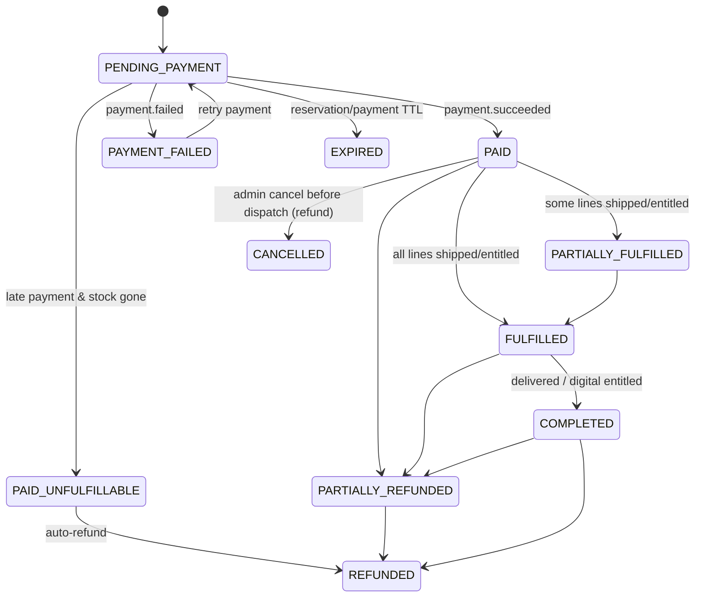
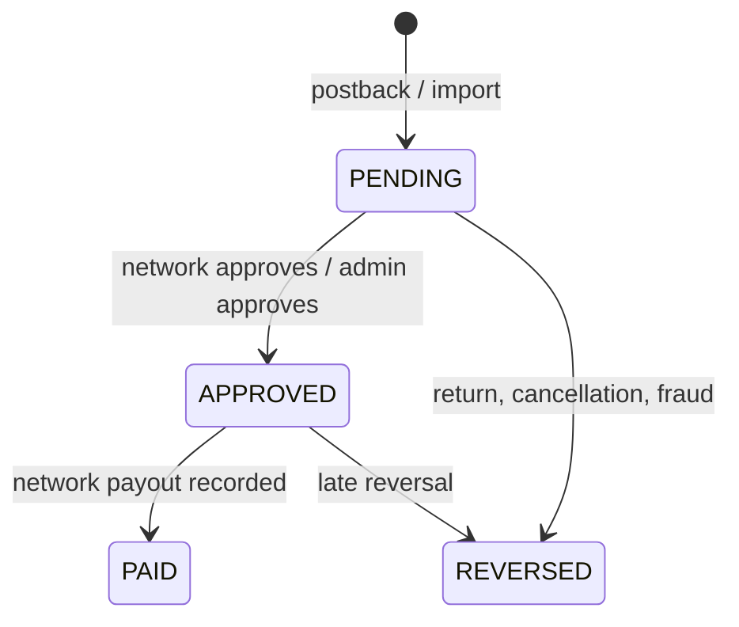

# Product Behavior Matrix

Status: **Proposed (pre-implementation)**

Every product has two independent attributes:

- `productType`: `PHYSICAL` | `DIGITAL` — *what* the product is.
- `sellingMethod`: `DIRECT` | `AFFILIATE` — *who* sells it. DIRECT = we take the money; AFFILIATE = an external merchant takes the money and we earn a commission.

`sellingMethod` decides the transaction path. `productType` decides fulfillment (only relevant when DIRECT) and display attributes.

---

## 1. Matrix

| Behavior | PHYSICAL + DIRECT | PHYSICAL + AFFILIATE | DIGITAL + DIRECT | DIGITAL + AFFILIATE |
|---|---|---|---|---|
| Typical example | T-shirt we ship | Gadget sold on a partner marketplace | E-book / course file we deliver | Software sold by vendor via affiliate network |
| Primary CTA | Add to cart | Buy at {merchant} → `/go/{code}` | Add to cart / Buy now | Get it at {merchant} → `/go/{code}` |
| Price source | catalog `variant_prices` (authoritative) | affiliate offer display price (indicative, with `priceCheckedAt` and disclaimer) | catalog `variant_prices` (authoritative) | affiliate offer display price (indicative) |
| Variants | Yes (size/color…) with SKU | Single default variant | Optional (e.g. Personal / Commercial license) | Single default variant |
| Cart | Yes | **Rejected (422)** | Yes | **Rejected (422)** |
| Order created | Yes | **Never** | Yes | **Never** |
| Payment (our PSP) | Yes | **Never** | Yes | **Never** |
| Inventory / stock | Yes — reserved at checkout, committed on payment | No (availability text only, from offer) | No (unless license-key pool → pool availability) | No |
| Shipping address required | Yes | No | No | No |
| Shipping charge / tax on shipping | Yes | No | No | No |
| Tax | Yes (server-computed) | No (merchant's responsibility) | Yes (digital-goods rules) | No |
| Fulfillment | Shipment(s) with tracking | Merchant | Entitlement + download links / license keys | Merchant |
| Customer library entry | No | No | Yes | No |
| Invoice from platform | Yes | No | Yes | No |
| Refund handled by platform | Yes (restock if not shipped) | No (merchant) | Yes (entitlement revoked) | No (merchant) |
| Returns (RMA) | Later phase | Merchant | N/A (refund policy) | Merchant |
| Affiliate click tracking | No | Yes | No | Yes |
| Commission tracking | No | Yes (conversions via postback/import) | No | Yes |
| Platform emails | Order confirmation, invoice, dispatched, delivered | None for purchase | Order confirmation, invoice, access granted | None for purchase |
| Owning services involved | catalog, commerce, payment, notification | catalog, affiliate | catalog, commerce, payment, delivery, notification | catalog, affiliate |
| FTC/ASCI-style affiliate disclosure shown | No | Yes | No | Yes |

## 2. Required fields at publish (catalog validation)

| Field / record | PHYSICAL + DIRECT | PHYSICAL + AFFILIATE | DIGITAL + DIRECT | DIGITAL + AFFILIATE |
|---|---|---|---|---|
| title, slug, storefront, category | Required | Required | Required | Required |
| ≥1 product image | Required | Required | Required | Required |
| Variant price (current) | Required, every active variant | Forbidden | Required, every active variant | Forbidden |
| SKU | Required per variant | Forbidden | Optional | Forbidden |
| Weight & dimensions (`physical_specs`) | Required | Optional (display only) | Forbidden | Forbidden |
| Inventory record (commerce) | Created automatically per variant (stock may be 0 → "out of stock") | — | — | — |
| `digital_specs` (format, delivery kind) | Forbidden | Forbidden | Required | Required (display only) |
| ≥1 `READY` asset or license pool (delivery) | — | — | Required | Forbidden |
| Delivery policy (download limit, access days) | — | — | Required (defaults allowed) | — |
| Affiliate offer (merchant, destination URL, link code) | Forbidden | Required; URL host must match merchant allowlist | Forbidden | Required; URL host must match merchant allowlist |
| Disclosure text | — | Required (default template) | — | Required (default template) |

## 3. Lifecycle rules

- Product status: `DRAFT → PUBLISHED → ARCHIVED` (`ARCHIVED → DRAFT` allowed for re-work if never sold).
- `productType`, `sellingMethod`, and `storefront` are **editable only while the product has never been ordered or clicked** (`type_locked = false`). After that, create a new product. This keeps order history, invoices, entitlements and affiliate reports coherent.
- Archiving a DIRECT product removes it from active carts (event-driven) but never affects existing orders, invoices, or entitlements.
- Archiving an AFFILIATE product deactivates its `/go/{code}` link (returns a friendly "no longer available" page with a link back to the storefront).
- Price changes never alter existing orders (snapshots).

## 4. Mixed carts

- A cart belongs to one storefront. It may contain PHYSICAL+DIRECT and DIGITAL+DIRECT lines together if the storefront carries both.
- Mixed order: shipping address required (because of physical lines); digital lines are entitled immediately on payment while physical lines go to fulfillment. Order status becomes `PARTIALLY_FULFILLED` until shipments complete.
- AFFILIATE products can never appear in a cart, regardless of type.

## 5. Order state machine (DIRECT only)

A digital-only order goes `PAID → FULFILLED → COMPLETED` as soon as all entitlements are granted.

## 6. Affiliate conversion state machine

## 7. Admin ownership

| Storefront | Who manages its products (all four combinations) |
|---|---|
| SHOP | E-Commerce Master Admin and SHOP staff with catalog permissions |
| DIGITAL | Digital Products Master Admin and DIGITAL staff with catalog permissions |

Neither Master Admin can see or change the other storefront's products, orders, merchants, assets, templates, or staff.
